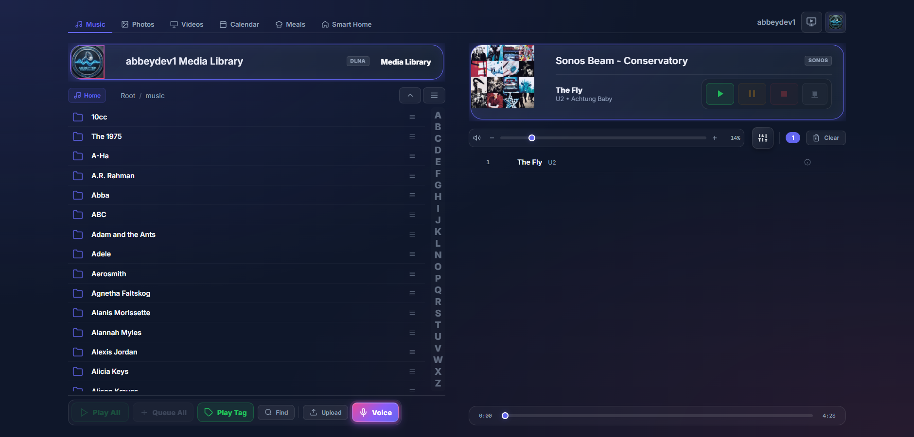
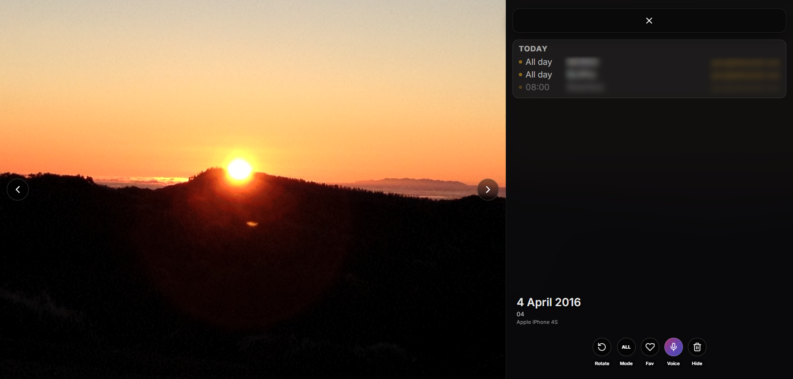
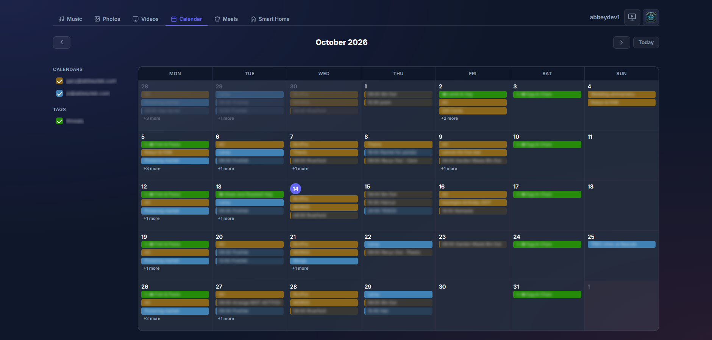
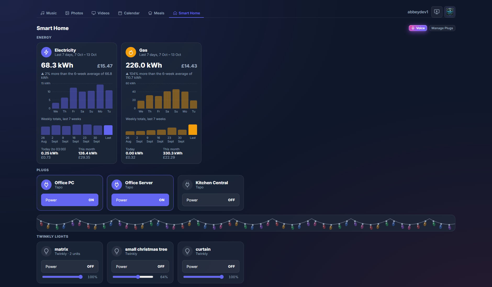
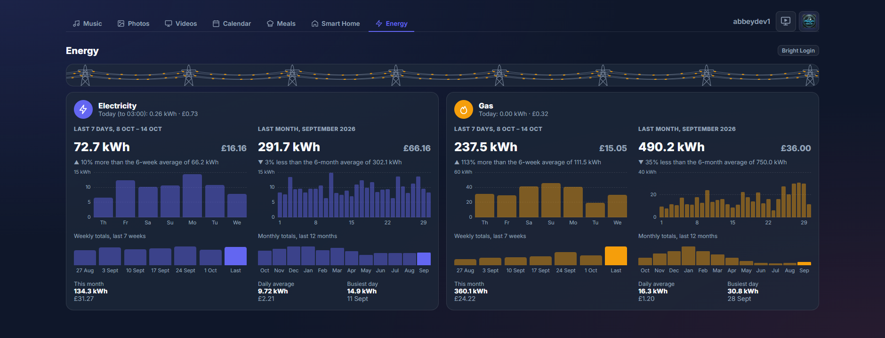
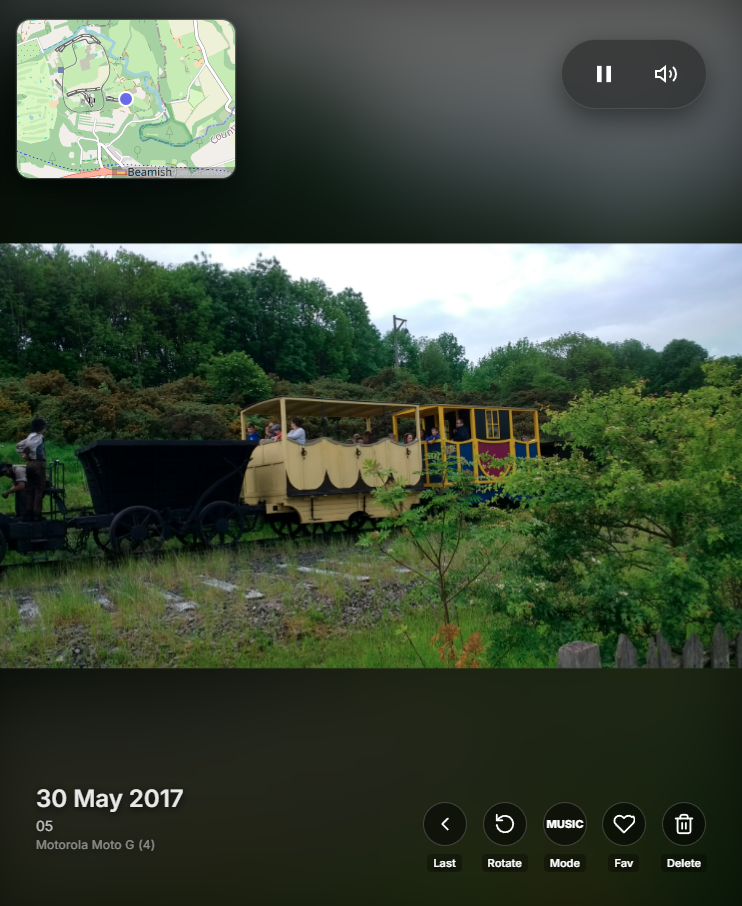
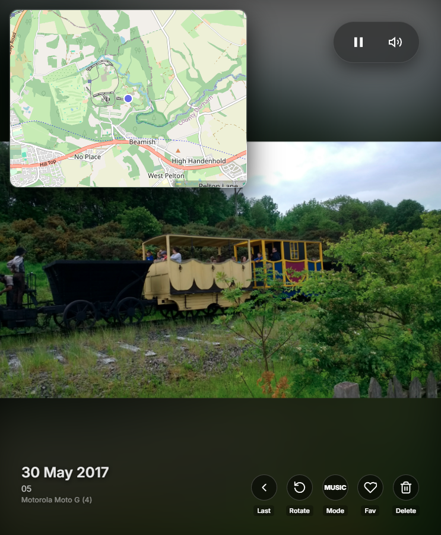
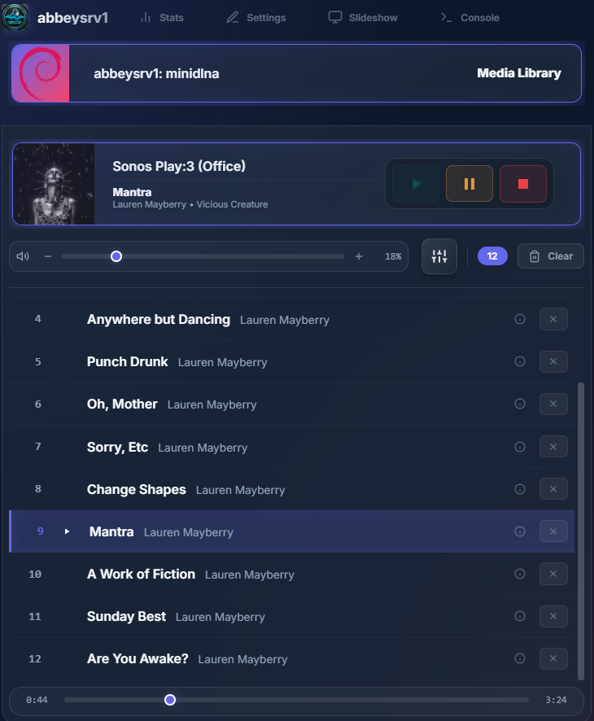

# Home Hub (AMMUI)

A web based home hub to manage and play your music, video and photo files. Send them to Sonos, TV, etc., a flexible slideshow, some smart home capabilities, calendar display, a basic meal manager and even a little game. 
<table>
<tr>
<td><br/><b>Music</b> - browse your library and play to Sonos, DLNA or AirPlay</td>
<td><br/><b>Slideshow</b> - family photos with today's calendar alongside</td>
</tr>
<tr>
<td><br/><b>Calendar</b> - shared family calendars</td>
<td><br/><b>Plugs and Lights</b> - smart plugs and Twinkly lights</td>
</tr>
<tr>
<td><br/><b>Energy</b> - electricity and gas use from your smart meter</td>
<td></td>
</tr>
</table>

## Features

* Maintain a local library of music, photos and videos.
* Send to local players (Sonos and DLNA players. Some Airplay support)
* Send from other local DLNA servers (Subsonic, MiniDLNA/ReadyDLNA, etc.)
* Display a slideshow of photos. Modes are: All, On this day, Favorites, Recent, Music (album art of playing track)
* Album art can be retrieved from discogs (via a Discogs API key)
* Lyrics from LRCLIB shown in the slideshow's Music mode. Sync'd as closely as possible.
* Identify untagged music tracks via AcoustID and fill in Title/Artist/Album/Year (via an AcoustID API key).
* Watch a track's music video on YouTube, right from the track list (via a YouTube API key - see [Music Videos](#music-videos)).
* Voice commands: say "play Wonderwall by Oasis", "queue the album Rumours", "next", "stop", "turn on the Christmas tree" (see [Voice Commands](#voice-commands)).
* Switch TP-Link Tapo and Kasa smart plugs and Twinkly lights on and off, and dim Twinkly lights, from the Plugs and Lights tab (see [Plugs and Lights](#plugs-and-lights)). Plugs that measure power (such as the Tapo P110) show how many watts they're drawing.
* Set countdowns and on/off schedules that are kept on the plugs and lights themselves, so they run even when AMMUI is off. Each card has a clock face shaded for the hours it's scheduled on (see [Timers](#timers)).
* See your home's electricity and gas use, and its cost, from your smart meter on the Energy tab: today so far, the last 7 days, last month and the last 12 months, compared with earlier weeks and months (via a free Bright account - see [Energy](#energy)).
* Family calendar: a month view of shared calendars from Google Calendar or any other iCal feed, each in its own colour and easy to show or hide, alongside your own entries with repeats and colour-coded tags. Today's events can show next to the slideshow.
* Meal planning with **items**. An item is either a single thing (e.g. Peas), with its quantity for one person, a picture and calories, or made of other items (e.g. Mash, Roast chicken), each at the amount it uses; those can be made of others in turn. Items are made and changed in the **item builder**, which searches Open Food Facts for a single item's name and picture, and your items for what one is made of. Plan a meal on the Meals tab's own Calendar by adding one or more items (or making a new one there and then), an optional name (e.g. *Sunday roast*) and which family members are eating. Meals stay off the main Calendar. A **meal plan** of 1 to 8 weeks gives a meal for each day, and a day's meal can repeat every so many days or weeks within the plan (e.g. pizza every Friday); from the date its Day 1 falls on it repeats on the Meals calendar, where days without a meal show the planned one faded, and adding a meal starts with the planned one (change it before saving if you like). The Meals tab has Calendar, Meal Plan and Items tabs down the left, with the shopping list alongside. Items can be exported and imported.
* A shopping list beside the meals, typed or by voice ("add milk"). It shares the items list with the meals: saved single items are suggested as you type, and new ones are added to it. Each item shows a picture of a matching product from Open Food Facts, preferring your supermarket's own brand if one is picked in Settings → General. Click a picture to choose a different product; the choice is kept for that item.
* Calories, protein, carbs, fat and alcohol units for each item and meal per person, from items looked up once in the UK food tables, Open Food Facts or the USDA database, or typed in (see [Calories](#calories)).
* Daily word game on the Games tab: guess the five-letter word in six tries, using a UK English dictionary. Everyone gets the same word each day, and each player keeps their own stats and streaks (see [Games](#games)).
* Sync library to an S3 storage provider (AWS, Wasabi, etc.). Use as backup by turning on S3 versioning.

## My journey to here...
I'd been using an Amazon Echo Show for a while. It was great but...
* I have a library of mp3s and was paying a subscription to a music service I could manage without.
* I have a library of photos. To get them on the Echo, I had to upload them to AWS.
* I didn't really have a backup strategy for the above.
* I'd get Adverts :-(
* I never really got the on-this-day slideshow I wanted. It didn't seem to quite work.
* It didn't hook in with my Google Calendars very well.
* I didn't really get the UI. Settings seemed hard to find, if they were there at all. I,ve designed a lot of UI heavy products and wanted something that made sense to me.
Some of this stuff may have changed since then but I wanted a home hub that's not tied too much to one company's ecosystem, that covers a diverse range of functions, that is built with a decent UI, that can run on a wide range of hardware and that isn't too expensive to deploy. 
## Target Hardware

The install contains the media server and a built in webserver to serve the UI. It should run on anything that can run node.js (Windows/Linux/MacOS) and will need storage space for the media library. The UI runs from a browser so any device with one should work. It can be on the same machine as the server and/or on any device on the local network to it. A touchscreen is highly recommended.

I initially had this running on a headless linux box and accessed the UI from an Android tablet, my work PC, my IPhone and a Raspberry PI 5 connected to a 15" display. I currently run the whole thing on a DELL Touchscreen All-In-One Optiplex 3011, bought from ebay for 70 quid, and it works really well.

## 🚀 Installation

### Windows

1. **Download the installer**: [ammui-setup.cmd](https://github.com/abbeytekmd/ammui/raw/main/installer/ammui-setup.cmd). If the link opens as text in your browser, go back, right-click it and choose *Save link as…*. If the browser says the file isn't commonly downloaded, choose *Keep*.
2. **Run it**: double-click the downloaded file. If Windows SmartScreen says "Windows protected your PC", choose *More info* → *Run anyway*.
3. **Answer the prompts** (see [What you may need to do](#what-you-may-need-to-do) below). Setup takes a few minutes, most of it downloading.
4. **Name your server**: when setup finishes, AMMUI opens in your browser at `https://localhost:3443`. Give the server a name when asked, and you're ready to go.

The installer is a one-off: once AMMUI is set up you never need it again. AMMUI keeps itself up to date.

#### What it installs

Anything already on the PC is left alone, so only what's missing gets installed.

| What | Why | Where it goes |
|---|---|---|
| **Node.js** (current LTS, v22.13 or newer needed) | Runs AMMUI | Installed for all users with winget, or from nodejs.org if winget isn't available |
| **Git** | Downloads the AMMUI code from GitHub | Installed with winget. If that isn't possible, the code is downloaded as a zip file instead |
| **AMMUI** and its packages | The app itself | `%USERPROFILE%\ammui` (your user folder). Your database, settings, certificates and local library are kept here too |
| **ffmpeg** (optional) | AirPlay, photo and video thumbnails, local playback of YouTube videos | `ffmpeg.exe` and `ffprobe.exe` in the AMMUI folder |
| **yt-dlp** (optional) | Plays YouTube videos that have embedding disabled | `yt-dlp.exe` in the AMMUI folder |
| **fpcalc** (Chromaprint, optional) | "Identify with AcoustID" | `fpcalc.exe` in the AMMUI folder |

It also adds these shortcuts:

* **AMMUI Server** on the desktop and in the Start menu: starts the server. Its window shows the server log; close the window to stop AMMUI.
* **AMMUI Server** in the Startup folder (`shell:startup`): starts AMMUI, minimised, every time you sign in to Windows.
* **AMMUI Kiosk** on the desktop: opens AMMUI full screen in Chrome (or Edge if Chrome isn't installed), for a dedicated display such as a wall-mounted screen or an all-in-one PC. Press Alt+F4 to close it. It needs the server to be running.

AMMUI is also listed in *Settings → Apps* as **AMMUI Media Hub**, so it can be uninstalled like any other program (see [Uninstalling](#uninstalling)).

#### What you may need to do

* **Allow the download and the file to run**: see steps 1 and 2 above. The installer is a plain script, so you can open it in Notepad to see exactly what it does.
* **Approve installs**: if Node.js or Git need installing, Windows asks for permission (*Yes* in the User Account Control prompt). This needs an administrator account or password.
* **Allow Node.js through the firewall**: the first time the server starts, Windows Defender Firewall asks about Node.js. Tick **Private networks** and choose *Allow*, otherwise your players (Sonos, DLNA, AirPlay) and other devices can't connect. This also needs an administrator.
* **Trust the AMMUI certificate**: AMMUI runs over HTTPS with its own certificate (see [Secure Access (HTTPS)](#secure-access-https)). The installer offers to trust it on this PC. Choose *Yes* in the Windows security warning so the browser and the kiosk don't show a certificate warning. Choosing *No* is safe; the browser will just warn you each time.
* **Set up your other devices**: open `https://<this PC's name or IP address>:3443/` on a tablet, phone or other computer. To stop the certificate warning there, install the certificate on each device as described in [Getting rid of the browser warning](#getting-rid-of-the-browser-warning).
* **Add API keys** (optional) under **Server Settings → Integrations**: a Discogs token (album art), an AcoustID key (identify tracks by their audio) and a YouTube key (music videos).

If something goes wrong the installer stops with a message in red and waits for a key press so you can read it. Fix the problem it describes and run the installer again; it carries on from where it got to.

#### Options

Run the installer from a command prompt to change what it does:

* Install somewhere other than your user folder: `ammui-setup.cmd D:\ammui`
* `set AMMUI_NO_EXTRAS=1` first to skip ffmpeg, yt-dlp and fpcalc.
* `set AMMUI_NO_STARTUP=1` first so AMMUI doesn't start when you sign in to Windows.
* `set AMMUI_NO_RUN=1` first to set everything up without starting the server.
* Or run it straight from a PowerShell window without saving the file: `irm https://raw.githubusercontent.com/abbeytekmd/ammui/main/installer/ammui-setup.cmd | iex`

### Other platforms (manual install)

AMMUI can be installed by hand on any system that runs Node.js.

#### Prerequisites
*   Node.js (v22.13 or higher, for its built-in SQLite)
*   npm
*   Git

#### Installation

1.  Clone the repository:
    ```bash
    git clone https://github.com/abbeytekmd/ammui.git
    cd ammui
    ```

2.  Install dependencies:
    ```bash
    npm install
    ```

3. Install ffmpeg for Airplay support, photo/video thumbnails and local playback of YouTube videos.
    ```bash
    sudo apt-get install ffmpeg
    ```
    or just download/install the package on Windows.

4. Install Chromaprint (`fpcalc`) for "Identify with AcoustID".
    ```bash
    sudo apt-get install libchromaprint-tools
    ```
    or on Windows download the Chromaprint build and put `fpcalc.exe` on your PATH. Then add a free AcoustID API key under Settings → Integrations.

5. Install [yt-dlp](https://github.com/yt-dlp/yt-dlp) so YouTube videos that have embedding disabled can still play locally (in the "Video" button on a track) instead of opening on youtube.com.
    ```bash
    sudo apt-get install yt-dlp
    ```
    or on Windows download `yt-dlp.exe` and put it on your PATH. ffmpeg (step 3) is also required for this: the video is copied and the audio re-encoded to AAC on the fly, as YouTube's Opus audio could drop out partway through playback.

#### Usage

1.  Start the application:
    ```bash
    npm start
    ```

2.  Open your browser and navigate to:
    ```
    https://localhost:3443
    ```
    From another device use the server's address instead, e.g. `https://192.168.0.2:3443`. The browser warns about the certificate until you trust it - see [Secure Access (HTTPS)](#secure-access-https). `http://localhost:3000` also works and redirects to the HTTPS address.

## Uninstalling

### Windows

1. Open *Settings → Apps → Installed apps* (on Windows 10: *Settings → Apps → Apps & features*). AMMUI is also listed in *Control Panel → Programs and Features*.
2. Find **AMMUI Media Hub**, open its menu (**⋯**) and choose *Uninstall*.
3. Confirm that you want to remove AMMUI.
4. Choose whether to **delete the AMMUI folder** (`%USERPROFILE%\ammui`, or wherever you installed it). This folder holds your AMMUI database and settings, and the local library: the music, photos and videos added to AMMUI's own server.
   * **No** (the default) keeps the folder, so nothing you added to AMMUI is lost and you can reinstall into it later.
   * **Yes** deletes it and everything in it. Back up anything you want to keep first (see [Backup and restore](#backup-and-restore)).
5. If Windows asks whether to delete the AMMUI certificate from the root store, choose *Yes*.

The uninstaller removes:

* the running AMMUI server and any open kiosk window (they're stopped first)
* the **AMMUI Server** shortcuts (desktop, Start menu and Startup folder) and the **AMMUI Kiosk** shortcut
* this PC's trust in AMMUI's certificate
* the AMMUI entry in *Settings → Apps*
* `%LOCALAPPDATA%\AMMUI` (the icon, the kiosk browser's profile and the uninstaller itself)
* the AMMUI folder, only if you said *Yes* in step 4

It leaves alone:

* **Node.js and Git**, as other programs may use them. Remove them from *Settings → Apps* if you don't need them.
* Music, photo and video folders elsewhere on your PC or network that AMMUI was browsing.
* Certificates installed on your other devices (tablets, phones, other PCs). Remove those in each device's certificate settings if you want to.

If the AMMUI entry is missing from *Settings → Apps*, run the uninstaller by hand from a command prompt:

```
powershell -ExecutionPolicy Bypass -File "%LOCALAPPDATA%\AMMUI\uninstall.ps1"
```

### Other platforms

Stop the server (Ctrl+C in its terminal, or stop the service if you set one up), then delete the folder you cloned AMMUI into. As on Windows, that folder holds the database, settings and local library, so back up anything you want to keep first.

## Slideshow:
* Starts after the app has been idle for a while and moves to the next photo on a timer. Set both in Settings > General (0 turns either timer off). It won't start while a game is in progress.
* iPhone Live Photos can play in the slideshow: check **Include videos** in Settings > General. When files are imported, a video with a photo of the same name beside it (a Live Photo's video) is filed next to the photo in the pictures folder rather than with the videos, and the slideshow plays it in place of the photo. Any other video in the slideshow's folder is included too. A video plays silently unless **Play video sound** is on; a short one stays on its last frame for the rest of the photo time, and a long one is cut short after **Play each video for up to** seconds.
* In the photo browser, Live Photos have a **LIVE** badge, and resting the mouse on one in the grid plays its clip. Opening one plays its clip once and then settles on the photo; press and hold the photo to play it again, with sound.
* Apply rotation to photos and the server will remember.
* Delete a photo to hide it from the slideshow in future.
* Go back to the last picture in the slideshow in case you just missed it.
* Previous / next arrows and the close button are always on screen, so they work with a single tap on a touchscreen. Close sits at the end of the bar in the top right.
* Overlay pause and volume controls for current music player, if active.
* Photo date and device used info is shown if available.
* Photos with location data present will show a small map overlay. Click on map to show larger view. 




## Tablet/Phone mode
* Player / server switchable panes.



## Local DLNA Server
* Upload button to add music, photos and videos from the device you're using: pick individual files or a whole folder.
* Download buttons on music and photos from other servers to add a copy to the local server.
* Back up all local music, photo and video files to S3 compatible storage (I use Wasabi), and restore them from it (see [Backup and restore](#backup-and-restore)).
* Several AMMUI servers can run on the same network and see each other's libraries. Give each one a different name (Server Settings → General).

## Music Videos
Watch a track's music video on YouTube, right from the track list. When the video ends, the player closes by itself.

> **A YouTube API key is required.** Without one nothing can be looked up, so tracks that haven't already been matched show no Video button. Create a free key in the Google Cloud console (enable the "YouTube Data API v3"), then paste it in **Settings → Integrations**. See [How music video matching works](#how-music-video-matching-works) for the details and quota limits.

### The Video button
* Solid: a video is known. Dashed ("Video?"): not searched yet (click to search now). Struck through ("No video"): searched and nothing was found (click to choose one).
* A gold star on the button shows how likely the video is to be the real thing:
  * **Full star** - found on the artist's own channel and it isn't a lyric, audio, visualiser, live, cover or remix upload.
  * **Half star** - a video from another channel that is titled "Official Video", or one you picked by hand from the search results.
  * **No star** - anything else, such as a lyric video or a live cut. It still plays.
* If a video is missing or wrong, open the track's File Information and choose "Find video on YouTube" to pick from the search results.
* The optional `yt-dlp` tool and ffmpeg let videos with embedding disabled play locally (see Getting Started).

## Voice Commands

Press the glowing **Voice** button at the right-hand end of the music browser's toolbar (or the one on the Plugs and Lights tab) and say what you want. Music plays on the currently selected player, from the currently selected media server. Smart home commands work from either button and don't need a player selected.

| Say | What happens |
|---|---|
| "play Wonderwall by Oasis", or just "Wonderwall by Oasis" | Plays that track, replacing the playlist |
| "play the album Rumours", "play Rumours album" | Plays the whole album in track order |
| "play something by Queen", "play the band Oasis", "play Queen" | Plays up to 200 of the artist's tracks, shuffled |
| "shuffle Folklore" | Plays the album shuffled |
| "queue Wonderwall by Oasis", "add the album Rumours to the queue" | Adds to the end of the playlist without interrupting what's playing |
| "stop", "pause", "resume" / "carry on" | Playback controls |
| "next", "skip", "previous", "go back" | Moves through the playlist |
| "louder", "quieter", "volume 30", "volume max" | Changes the volume |
| "turn on the curtain", "switch the kettle off", "Christmas tree on" | Switches a plug, an outlet of a power strip, or a set of Twinkly lights |
| "turn off all the lights", "turn everything off" | Switches all the Twinkly lights, or every device |
| "set the Christmas tree to 40 percent", "dim the curtain to 20" | Sets the brightness of Twinkly lights (and turns them on) |
| "set the matrix to Snowstorm", "show Orbs in Orbit on the matrix", "make the tree red", "set the curtain to effect 3", "set all the lights to green" | Changes what Twinkly lights show: a scene from the Twinkly app by name, a colour, a built-in effect, or "the playlist" |

* A control word on its own is a command, but with "play" in front it's a search: "stop" stops the music, while "play Stop" finds a song called Stop.
* If a song and an album have the same name, the song is played unless you say "album".
* "play something by the Beatles" plays the song "Something" if the artist has one, and only otherwise plays a mix of their songs.
* Devices are matched by the names on the Plugs and Lights tab, loosely: "the tree lights" finds "small christmas tree", and "matrix two" finds "matrix2". If two devices fit equally well, nothing is switched and it says which two it could be; renaming one in **Manage Plugs** fixes that. Hidden devices aren't switched by voice.
* Matching allows for how speech recognition writes things, so "rumors" finds "Rumours", "and" matches "&", "AC DC" finds "AC/DC", and your pronunciation of an artist's name doesn't have to produce the exact spelling.

### Requirements and privacy

* The page must be opened over HTTPS, as browsers only allow the microphone on secure pages (see [Secure Access (HTTPS)](#secure-access-https)).
* Works in Chrome, Edge and Safari. Firefox has no speech recognition, so the button is hidden there.
* The **browser** turns your speech into text using its maker's service: Chrome sends the audio to Google, Edge to Microsoft, and Safari uses Apple's recognition. Only the resulting text is sent to AMMUI, and finding the music and switching devices happens entirely on your server and network.

## Plugs and Lights

The **Plugs and Lights** tab shows a card for each smart plug and set of Twinkly lights on your network, with a button to switch it on and off. Plugs that measure power (such as the Tapo P110) also show how much they're drawing, and Twinkly lights have a brightness slider. The cards refresh every 10 seconds while the tab is open, so a plug switched from its own app or button shows up here too.

### Supported plugs

* **TP-Link Tapo** plugs (P100, P110, P115 and similar) on current firmware, which uses TP-Link's newest login (TPAP). Only single plugs for now, not Tapo power strips.
* **TP-Link Kasa** plugs and power strips on the original Kasa firmware.
* **Twinkly** lights (strings, curtains, trees and so on). They need no login. Turning them on brings back whatever they were last showing (a movie, playlist, colour or effect) since the server started, or the current movie otherwise.
  The **scene** button on a Twinkly card shows what the lights are playing and opens a list to change it: the movies sent to the lights from the Twinkly app (under their names in the app), the playlist if there is one, the five built-in effects, or a plain colour. Choosing one turns the lights on.
  Units paired in the Twinkly app (to show one picture across several sets) appear as a single card, under the main unit's name, and switch and dim together. Voice commands answer to any of the paired units' names.

Tapo and Kasa devices still on the older KLAP login are listed but can't be switched yet; the Plugs tab says so. Other plugs (Tuya / Smart Life, Shelly, Tasmota, Belkin WeMo and so on) aren't supported yet.

### Timers

The clock button on a card opens its **Timers**. These are kept on the plug or lights themselves, so they still run when the AMMUI server is off, and timers set in the Tapo, Kasa or Twinkly app show up here too.

Once a device has a schedule, its clock button becomes a small clock face for the current half of the day (labelled AM or PM), shaded for the hours it's scheduled to be on, with a hand at the current time. Hover over it to see the whole day's on-times.

* **Countdown** (Tapo and Kasa): turn the plug on or off after 15 minutes to 8 hours. A plug holds one countdown at a time.
* **Schedule** (Tapo and Kasa): turn the plug on or off at a time of day, every day or on the days you pick. A schedule can be switched off without deleting it. Sunrise and sunset schedules made in the app are listed but can only have their time changed to a fixed one.
* **Twinkly** lights have one daily on time and one daily off time, with no countdown and no choice of days. Saving a time also sets the lights' clock from the AMMUI server's clock, so if the server runs on a different timezone from your house, the times follow the server. Paired units are all set together.

Timers aren't offered on Kasa power strips yet.

### Setting up

1. Set the plugs up in the Tapo or Kasa app (or the lights in the Twinkly app) as usual, on the same network as the AMMUI server.
2. Open **Devices** from the menu and go to the **Plugs** tab. Plugs are found automatically when the server starts and every 10 minutes after that; press **Seek** to search now.
3. For Tapo plugs, enter the **email and password of the TP-Link account** the plugs were set up with, and press **Save & Connect**. It should say how many plugs it connected to. Kasa plugs on the original firmware and Twinkly lights don't need a login.
4. Rename a plug with the pencil button, or **Hide** one you don't want on the Plugs and Lights tab. **Forget** removes a plug from the list; it comes back the next time it's found.

Plugs and lights take their names from the Tapo or Twinkly app unless you rename them here.

### Good to know

* **Everything stays on your network.** The password is checked by the plugs themselves, and switching never goes through TP-Link's cloud. The login is stored in the server's settings database.
* **A wrong password isn't retried.** Tapo plugs lock themselves for a while after too many failed logins, so once a plug refuses the password AMMUI stops trying it until you save a different one. A card that says *Wrong TP-Link password* has a button that goes straight to the login.
* **Check that the server can see broadcasts.** Plugs are found by a broadcast on the local network (UDP ports 9999, 20002 and 5555), so they must be on the same subnet as the server, and the server machine's firewall must allow those replies.
* If a plug's address changes (for example after a router restart), it's picked up again at the next search.

## Energy

The **Energy** tab shows your electricity and gas use from your smart meter, with a card for each showing today so far and, side by side:

* **The last 7 days** day by day, compared with the 6 weeks before, weekly totals for the last 7 weeks, and this month so far.
* **Last month** day by day, compared with the 6 months before and with the same month a year earlier, monthly totals for the last 12 months, and last month's daily average and busiest day. Each monthly bar has a line across it showing the same month a year earlier, once there are readings from that far back (see [How far back the history goes](#how-far-back-the-history-goes)).

Costs are shown alongside where the Bright account has them. It's read through the free **Bright** app (by Hildebrand), so you need a Bright account linked to your meter first.

To set it up, press **Bright Login** on the Energy tab (or open **Devices** from the menu and go to the **Plugs and Lights** tab), enter the email and password of your Bright account under **Smart Meter (Bright)** and connect. Readings come from your meter via Bright's servers and are usually an hour or two behind; the tab re-reads them every 5 minutes while it's open.

### How far back the history goes

A smart meter only keeps about 13 months of readings. When you first sign up to Bright, it collects whatever your meter still holds, so your history starts roughly 13 months before you signed up, and nothing before that can be fetched.

Comparing a month with the same month a year earlier needs readings from both months, so the year-earlier lines on the monthly bars (and the comparison under last month's total) may not show at first. After a while, as the history builds up, they start to appear month by month until all 12 bars have one. Nothing needs setting up for this; it happens on its own.


## Calories

The **Meals** tab can show how many calories, and how much protein, carbohydrate and fat, each item and meal has per person. These are set once on each single item, from the **Items** list or the item builder. An item made of other items then adds up what it's made of, at the amounts it uses.

### Where calories come from

The Calories dialog can look in three places. Pick one with the tabs at the top.

| Tab | What it has | Needs |
| --- | --- | --- |
| **UK foods** (the default) | About 2,850 basic foods with UK names and UK figures, such as *Aubergine, raw*, *Swede, boiled* or *Bacon rashers, back, grilled*. These come from McCance and Widdowson's *Composition of Foods*, the UK's official food tables. | Nothing. It's built into AMMUI and works offline. |
| **UK products** | Packaged products sold in the UK, such as Heinz beans or Warburtons bread, from [Open Food Facts](https://uk.openfoodfacts.org/). It knows the pack size, so *"1 tin"* works without entering a weight. | An internet connection. No key. |
| **USDA** | US foods from [USDA FoodData Central](https://fdc.nal.usda.gov/), including weights for cups, slices and single items. It uses American names (*eggplant*, *zucchini*, *cilantro*). | A free API key (see below). |

The dialog remembers the tab you used last.

#### USDA key (optional)

1. Sign up at [fdc.nal.usda.gov/api-key-signup](https://fdc.nal.usda.gov/api-key-signup). The key arrives by email straight away.
2. Paste it in **Settings → Integrations → USDA FoodData Central API Key** and press Save.

The key allows 1,000 lookups an hour.

### Adding calories to an item

1. In the **Items** list, press **+ kcal** next to a single item (or the calories button in the item builder).
2. AMMUI searches for its name and lists matching foods with their calories per 100 g. Close misspellings are found too (*"brocolli"* finds broccoli). If nothing useful comes up, try another tab or a simpler name (*"chicken breast"* rather than *"skinless chicken fillets"*). For USDA, tick **Include branded products** to search US packaged foods as well.
3. Pick the closest match. This fills in **Calories per 100 g** and the grams of **Protein**, **Carbs**, **Fat** and **Alcohol** per 100 g, plus any weights the source knows: the pack size for a UK product, or a cup, a slice and one medium item for a USDA food.
4. If the item's unit isn't a weight, check the **Weight of 1 …** box (see below). The UK food tables don't list weights for single items, so for *"2 eggs"* or *"1 onion"* enter how much one weighs.
5. Press **Save**. The line underneath shows what the item comes to, e.g. *"1 onion (150 g) ≈ 53 kcal · 1.5 g protein · 12 g carbs · 0.2 g fat per person"*.

You can also skip the search and type the figures per 100 g from a packet label. Protein, carbs, fat and alcohol can be left empty; only calories are needed. Alcohol is grams per 100 g (or 100 ml), not % ABV: a 5% beer has about 4 g. Open Food Facts gives % ABV, and AMMUI converts it. Carbs are *available* carbohydrate, as UK labels give it (fibre isn't included), and USDA figures are adjusted to match. To change an item's calories later, click its calorie figure. **Remove** clears them.

Each item is only looked up once. The result is saved in AMMUI's database, so items show their calories straight away and work without an internet connection.

### How amounts are converted

Calories are worked out from the amount and unit each item made of others uses, so the same item can be measured differently in different ones. An item made of others that's part of another counts as many of it as its amount says (blank is one).

| Unit | How it's converted |
| --- | --- |
| g, kg, oz, lb | Directly by weight |
| cup, tbsp, tsp, ml, l | The food's own weight for that measure if the source lists one. Otherwise it's worked out from another volume it does list, or as if it weighed the same as water |
| No unit ("2" onions) | The weight of one item that you enter, or USDA's medium size where it has one |
| tin, can, packet, pack, jar, bag, box, bottle, pot, tub, carton, pouch, bar | The weight you enter for one. If you haven't entered one, the product's pack size from Open Food Facts |
| Anything else (bunch, pinch, serving…) | The weight you enter for one, in **Weight of 1 …** |

Amounts can be whole numbers, decimals (*0.5* or *0,5*), fractions (*1/2*, *1 1/2*, *½*) or ranges (*2-3* counts as 2.5). A unit typed with no amount, such as *pinch*, counts as one of it.

Each item row shows its calories; hover over the figure for its weight, protein, carbs and fat. **? kcal** means AMMUI doesn't know the weight of that unit yet; click it to enter the weight. In the item builder, an item made of others shows its total, e.g. *"About 650 kcal · 32 g protein · 70 g carbs · 21 g fat per person"*, with UK alcohol units added when any of its items has alcohol (one unit is 8 g), and how many items aren't counted yet. Hover over the total to see which ones those are, and which counted items have no protein, carbs or fat.

Items given calories before AMMUI kept protein, carbs, fat and alcohol get them filled in automatically when the server starts, from the food they were looked up from. That needs an internet connection for UK products and USDA foods (and the USDA key for those). Calories that were typed in aren't changed.

### Good to know

* Figures are estimates. Food tables give averages, products change their recipes, and the weight of "one onion" or "a cup of rice" varies, so treat totals as a rough guide.
* Open Food Facts figures are typed in from labels by its users. AMMUI catches the common slip of entering kJ where kcal should be, but check a figure against the packet if it looks odd.
* Calories are included when items are exported. Importing fills them in for any item here that doesn't have them yet, and never overwrites ones already set.
* The USDA key is copied along with the other keys by **Settings → Integrations → Copy Keys From Another Device**.
* The UK food tables are © Crown copyright: Public Health England (2021), *McCance and Widdowson's The Composition of Foods Integrated Dataset*. They contain public sector information licensed under the [Open Government Licence v3.0](https://www.nationalarchives.gov.uk/doc/open-government-licence/version/3/). The copy built into AMMUI is made from the published spreadsheet by `scripts/build-cofid.py`, which can be re-run when a new edition comes out. Open Food Facts data is available under the [Open Database License](https://opendatacommons.org/licenses/odbl/1-0/).

## Games

The **Games** tab has a daily word game: guess the five-letter word in six tries. After each guess the tiles turn green for a letter in the right place, amber for a letter that's in the word but somewhere else, and grey for a letter that isn't in it. The on-screen keyboard keeps track of the letters you've tried, or you can type on a keyboard.

* **A new word every day, the same for everyone.** The word changes at midnight, and every device picks the same one for the same day without needing to talk to the server or each other, so the family can compare how they got on.
* **UK English.** Words come from the British English lists of [SCOWL](http://wordlist.aspell.net/) (the word lists behind many spell checkers), so British spellings such as *odour* and *kerb* are accepted and American ones such as *color* aren't. The daily word is always a fairly common word, with plurals and past tenses such as *cakes* and *baked* left out. Guesses can be any word from a much larger list. The lists are downloaded the first time the tab is opened (about 1.3 MB) and kept by the browser after that.
* **Players.** Add the people who play in **Server Settings** → **Family** (the same people meals are planned for). Pick who's playing at the top of the tab before starting; each device remembers who played on it last. Each player's game and stats (games played, win rate, current and best streak) are kept on the server, so they're the same on every device, and a day's word can only be played once per player.
* **No spoilers.** When a game is finished the letters are cleared, leaving just the coloured tiles, so others can see how it went without seeing the word.

Removing a family member also deletes their games and stats, and takes them off planned meals.

## Secure Access (HTTPS)

AMMUI serves the app over HTTPS on port **3443**, e.g. `https://192.168.0.2:3443/`. Opening the page over plain HTTP (port 3000) redirects there automatically.

Port 3000 still runs plain HTTP in the background and must stay open. Players (DLNA, Sonos, AirPlay) and AMMUI's own DLNA server fetch music, album art and device descriptions from it, and they can't use HTTPS with a self-made certificate. If the server machine has a firewall, allow both ports 3000 and 3443.

### The certificate

There's no public certificate for an address on your home network, so AMMUI makes its own on first start and keeps it in the `certs` folder next to the database:

* `ca.crt` / `ca.key`: AMMUI's own certificate authority, valid for 10 years.
* `server.crt` / `server.key`: the certificate the server uses. It covers `localhost`, the machine's name, `name.local` and every network address of the machine. It is renewed automatically at startup when an address changes or it's close to expiring.

The `certs` folder holds private keys, so it isn't committed to git. Delete it and restart to start over with a new certificate.

### Getting rid of the browser warning

Until a device trusts AMMUI's certificate, browsers show a "connection is not private" warning. You can click through it (Advanced → Proceed) and everything, including voice commands, works. To remove the warning for good, go to **Settings → General → Secure Access (HTTPS)**, press **Download Certificate** on each device, and install it as a trusted root certificate:

* **Windows**: press **Install on this PC** instead, open the downloaded `trust-ammui.cmd` and choose *Yes* in the Windows security warning (if SmartScreen appears, choose More info → Run anyway). Restart the browser. Or install it by hand: open the downloaded certificate → Install Certificate → Local Machine → "Place all certificates in the following store" → **Trusted Root Certification Authorities**. Restart the browser.
* **Android**: Settings → Security → Encryption & credentials → Install a certificate → **CA certificate**, and choose the downloaded file.
* **iPhone / iPad**: in Safari, press **Install on this iPhone / iPad** and allow the profile, install it under Settings → General → VPN & Device Management, then turn it on under Settings → General → About → **Certificate Trust Settings**.
* **macOS**: press **Install on this Mac** instead, open the downloaded `ammui.mobileconfig`, then in System Settings search for **Profiles**, double-click AMMUI and choose Install. Or by hand: open the certificate in Keychain Access, then double-click "AMMUI Local CA" and set **Trust → When using this certificate** to Always Trust.

Each device only needs this once: when the server certificate is renewed it's signed by the same authority, so it stays trusted.

## Build your own Media Hub

You need a machine for the server and one or more machines to run the UI. They can be the same machine or different ones.

The server will store your media files so will need a lot of disk space. It can also transcode video when sending it to the UI so the more power it has, the better. It needs to be available when you need it so if you have a box that's on all day, a linux box or similar, that would be ideal.

The UI ideally needs a nice big touchscreen. A 10inch or more tablet/Ipad, a raspberry pi with an external touchscreen monitor.

Both in the same machine: An All-in-one touchscreen PC, an MS Surface, etc.

## Managing your music library

Your local library lives in the `local/music` folder on the server, organised as `Artist/Album/Track`. Everything is served over DLNA, so folder names and file tags both matter: players show the tags, while the folders decide where a track sits. Most of the tools below exist to keep those two in agreement.

Browse the local server in **Music** mode to see the commands. Most of them are on the local server only.

### Getting music in

* **Upload** (toolbar): choose **Files…** to pick one or more files, or **Folder…** to add a whole folder of music, photos or videos. Music is filed into `Artist/Album/Title` using the file's tags, falling back to `Unknown Artist` / `Unknown Album` when tags are missing. Supported: mp3, flac, m4a, aac, wav, ogg and opus. Photos and videos are filed into `Year/Month` if a date can be determined from the file. Files that are already there are skipped.
* **Download** (row menu, on a track or folder from another media server): copies it into the local library. Folders download in the background with a progress window, and files that already exist are skipped.

### Folder menu (the ☰ button on each row)

| Command | What it does |
|---|---|
| **Build Album** | Gathers scattered tracks that share an album title (for example a compilation split across artist folders), lets you tick which ones to include and choose the artist folder (`Various Artists` or one of the existing artists, or your own name), then moves them into one album folder. |
| **Rename** | Renames the folder. If a folder with that name already exists you're asked whether to merge into it. |
| **Merge Into** | Moves everything in this folder into another folder alongside it (pick from the suggestions or type a new name), for example to combine `The Beatles` and `Beatles`. |
| **Reimport (Move to Tag Locations)** | Moves every track in the folder to `Artist/Album` folders that match its own tags, as a fresh import would. Exact duplicates are removed, and a different file already at the destination is left alone and reported as a failure. Empty folders left behind are cleaned up. |
| **Identify Tags from Filename** | For files with missing or generic tags (blank, "Unknown", "Track"), guesses artist and title from the file name and confirms the guess against Discogs before writing the tags. Files that already have tags are untouched. Needs a Discogs token in Settings. |
| **Sync File Tags** | Writes the folder names into the files: the album folder becomes the Album tag and the artist folder becomes the Artist tag, for every audio file inside. Use it after you've renamed or merged folders. This is the opposite direction to Reimport. |
| **Delete** | Permanently deletes the file or folder from the library. There is no recycle bin for music. |
| **Download** | Only appears for other servers' content (see above). |

On a single track the menu also offers **Sync File Tags**, **Delete**, and, when the file's folder doesn't match its tags, **Move to Tag Location** (moves just that file, as Reimport does for a folder).

### File information panel (the ⓘ button on a track)

The ⓘ button turns red and pulses when a track's `Artist/Album` folders disagree with its tags, which is the cue to fix one or the other. The panel shows the file's metadata and, for local files, lets you edit it:

* **Title, Artist, Album Artist, Album, Year**: edit a field and press **Save** to write it into the file.
* **All** (next to Artist, Album Artist and Album): copies that value to every track in the same folder.
* **Identify with AcoustID**: fingerprints the audio and looks it up on AcoustID. On a confident match it fills in Title/Artist/Album/Year, highlighted for you to review before saving. Nothing is written until you press Save. Needs an AcoustID key in Settings and `fpcalc` installed.
* **Tags / favourite**: label a track with your own tags, which can then be played from the Play Tag button. Favourite is a reserved tag.

### A typical clean-up

1. **Upload** or copy the new music in.
2. On folders with untagged tracks, run **Identify Tags from Filename**, or open a track's ⓘ and **Identify with AcoustID**.
3. Run **Reimport** on the folder so tracks land in the right `Artist/Album` folders.
4. Use **Build Album** for compilations, and **Rename** / **Merge Into** to tidy near-duplicate artist folders.
5. Run **Sync File Tags** on anything you renamed or merged so the files match their folders.
6. Check the red ⓘ buttons for anything that still disagrees, and fix the album art.
7. **Export Tags** and **Back Up Now** to keep a backup.


### Album art

Art is looked up in this order: a `folder.jpg`, `cover.jpg`, `folder.png`, `cover.png`, `album.jpg` or `artwork.jpg` in the same folder, then a picture embedded in the file, then an automatic Discogs search by artist and album (needs a Discogs token in Settings). If a track still has no art, or the wrong one, use the **Retry album art** button (the picture icon just left of the close button on the slideshow's music bar) to search Discogs by artist and album yourself and pick a replacement.

### Menu and settings commands

* **Set Home** (top of the browser, ☰): remember this folder as the starting point for Music browsing. It also sets where **Build Album** puts new albums.
* **Logs** (logo menu): see what a command did and why it failed, filtered by type (for example `IDENTIFY`, `TAGS`, `UPLOAD`).
* **Playback Stats** (logo menu): your 100 most played tracks, and the 100 albums with the most track plays (every play of a track counts towards its album). The lists scroll.
* **Server Settings → General → Local Library**: file counts and sizes for what is stored on the server.
* **Server Settings → General → Tags**: **Export Tags** saves all your file tags (favourites included) to a file. **Import Tags** loads one, matching files by path and falling back to file name if they've since moved. Use this to back up your tagging or copy it to another AMMUI.
* **Server Settings → Integrations**: the Discogs token (album art and filename identification), AcoustID key (audio fingerprinting), YouTube key.
* **Server Settings → Backup**: back up to, and restore from, an S3 bucket. See [Backup and restore](#backup-and-restore).
* **Server Settings → Updates**: AMMUI checks GitHub for a new version shortly after it starts and then once a day, and shows a badge in the menu when one is available.

### Backup and restore

**Server Settings → Backup** works with any S3 compatible bucket (AWS, Wasabi, Backblaze, Cloudflare R2...).

1. **S3 Connection**: enter the endpoint, region, bucket, access key and secret key, then press **Test Connection**. The test lists the bucket, then writes and removes a small test file, and tells you what will work:
   * green: backup and restore both work.
   * amber: the keys are read-only (restore works, backups will fail), or they can't delete (the "delete files no longer on this server" option won't work, and the test file is left behind).
   * red: what's wrong, such as an unknown access key, wrong secret key, missing bucket, wrong region or unreachable endpoint.

   The Backup and Restore sections appear once the test passes. Changing any connection detail hides them again until it's re-tested.
2. **Backup**: **Back Up Now** copies the local music, photos and videos into a folder in the bucket named after this server. Tick **Back up automatically every day** to run it daily. Deleted photos and .DS_Store-type housekeeping files are left out, and a file whose size has changed is uploaded again.
   * **Delete files from the bucket that are no longer on this server**: off by default, so the bucket keeps everything ever backed up. When on, each backup also removes anything in this server's folder of the bucket that has been deleted, moved or renamed locally. If more than the set percentage (default 10%) would be removed, nothing is deleted and the log says why, which protects the backup if the library drive is missing or emptied. Turning on versioning in the bucket lets you recover anything deleted by mistake.
3. **Restore**: lists the folders in the bucket (one per server that has backed up to it). Pick one and press **Restore** to download everything in it into this server's library. Files already here with the same size are skipped, so an interrupted restore can simply be run again. A local file with a different size is replaced. This is how to move a library to a new machine: set up the connection there, then restore the old server's folder.

The status box underneath shows progress for both. **View Log** shows the result of the last backup or restore, with counts for each folder.

### Logs

Open the logo menu and choose **Logs** to see the discovered devices (IP address table) and a live log of the server and browser. Use the type dropdown above the log window to show a single log type, such as `YOUTUBE`, `IDENTIFY`, `DEVICES` or `DEBUG` (DEBUG is hidden from the default "All types" view because it is noisy). Log lines are given a type from their `[TAG]` prefix; untagged messages are grouped by keyword. The server keeps the last 1000 lines and the browser the last 500.

The server also writes its log to `logs/ammui.log` in the AMMUI folder, so there's a record even if the server crashes or is restarted. Each start and exit is marked with a `---- Server starting ----` / `---- Server exiting ----` line; a start with no exit before it means the server stopped unexpectedly. When the file reaches 5 MB it's renamed to `ammui.log.1` (older ones move up to `.2` … `.5`, and the oldest is deleted), so the logs never take more than about 30 MB.

## How music video matching works

This describes what happens behind the Video button (see [Music Videos](#music-videos) for what the button shows).

**Requires a YouTube API key** in Settings → Integrations. All lookups use the YouTube Data API. Without a key no searching happens, so tracks that haven't already been matched show no Video button.

### How a video is found
1. The local database is checked first. Matches are remembered, so a folder you have opened before costs nothing.
2. Otherwise the artist's YouTube channel is located once (a channel called "... - Topic" is skipped, as it only holds audio). Its uploads are read 50 at a time, just until the track turns up, and every page is stored so other albums by the artist match without more API calls.
3. If the only match on that channel is a live, audio or lyric cut, the rest of the channel is read to look for a better one.
4. If the artist's channel has no proper video, YouTube is searched for the track and a result is used only if its title says "Official Video" (or "Official Music Video"), it is the right song and it isn't a lyric, audio or live cut. That is marked with a half star. If nothing qualifies, the live/audio/lyric match from step 3 is used unstarred, or the track is marked "No video".

### Fixing a wrong or missing video
* Open the track's File Information and choose "Find video on YouTube" to pick from the search results. Your choice is saved and gets a half star.
* In the Database Stats dialog (menu), the YouTube section has a **Re-match non-official videos** button. It forgets every matched video that has no star, so they are looked up again the next time you browse (stored channel uploads are reused, but a track that needs the "Official Video" search uses quota as described below). Starred videos, including ones you picked by hand, are kept.

### Quota and limits
* A channel search or a whole-of-YouTube search costs 100 of YouTube's 10,000 daily quota units; reading a page of uploads costs only a unit or two. Channel searches are capped at 60 a day and the "Official Video" searches at 30 a day, so a large library may take a few days to fill in. Tracks that hit a cap stay dashed and are retried later.
* If YouTube reports its quota is used up, automatic lookups pause for an hour.

## ⚙️ Built With

*   **Node.js & Express** - Backend server
*   **node-ssdp** - UPnP/DLNA discovery
*   **sonos** - Sonos device support
*   **node-forge** - HTTPS certificate generation
*   **Vanilla JS & CSS3** - Frontend interface

## Tested with

### Sonos:
* Sonos Play 5 Gen 1
* Sonos Play 3 Gen 1
* Sonos Beam Gen 1

### Airplay:
* Logitech UE Wireless Air Speaker S-00118

### DLNA Clients:
* Linux upmpdcli

### DLNA Servers:
* ReadyDLNA/MiniDLNA
* Subsonic
* JRiver Media Center (Windows)
* Windows Media Player

## 📄 License

This project is licensed under the MIT License.

The Tapo smart plug login (`lib/smart-home/tpap.js`, `lib/smart-home/p256.js`) is ported from [tapo](https://github.com/mihai-dinculescu/tapo) by Mihai Dinculescu, also MIT licensed. Its copyright notice is included in [LICENSE](LICENSE).
